<a href="https://github.com/adarzhpathade">
  
</a>

<p align="center">
  <a href="https://www.linkedin.com/in/adarzhpathade/"></a>
  <a href="mailto:adarzhpawar@gmail.com"></a>
  <a href="https://github.com/adarzhpathade?tab=repositories"></a>
</p>

<br>

## ✦ About

I like building interfaces that feel **alive**: responsive, accessible, and quietly animated. Most of my work lives in the React and Next.js world, and I'm growing into full-stack architecture while sharpening my problem solving with Data Structures & Algorithms in Java.

```ts
const adarsh = {
  role:      "Frontend-focused Web Developer",
  education: "B.Tech in CS & IT · 2024 → 2028",
  focus:     ["UI engineering", "motion design", "full-stack architecture"],
  practice:  "DSA in Java",
  loves:     "turning Figma frames into pixel-perfect, buttery-smooth UIs",
};
```

## ✦ Tech Stack

<p align="center">
  <br>
  <br>
  <br>
  
</p>

<p align="center">
  <sub>also: GSAP · Framer Motion · Drizzle ORM</sub>
</p>

## ✦ Featured Projects

<p align="center">
  <a href="https://github.com/adarzhpathade/Eligify"></a>
  <a href="https://github.com/adarzhpathade/Store-Supervision-Platform"></a>
</p>

<p align="center">
  <a href="https://eligify-gamma.vercel.app">Eligify live demo ↗</a>
  &nbsp;·&nbsp;
  <a href="https://store-supervision-platform.vercel.app">StoreSync live demo ↗</a>
</p>

## ✦ Contribution Activity

<picture>
  <source media="(prefers-color-scheme: dark)" srcset="https://raw.githubusercontent.com/adarzhpathade/adarzhpathade/output/snake-dark.svg">
  <source media="(prefers-color-scheme: light)" srcset="https://raw.githubusercontent.com/adarzhpathade/adarzhpathade/output/snake-light.svg">
  
</picture>

<p align="center"><sub>Built with curiosity, caffeine & a lot of <code>git push</code>.</sub></p>
