<samp>
  (LIVE) &nbsp;<a href="https://eligify-gamma.vercel.app">ELIGIFY ↗</a> &nbsp;/&nbsp; <a href="https://store-supervision-platform.vercel.app">STORESYNC ↗</a> &nbsp;/&nbsp; <a href="https://adrz-26.vercel.app">PORTFOLIO ↗</a>
</samp>

<picture>
  <source media="(prefers-color-scheme: dark)" srcset="https://raw.githubusercontent.com/adarzhpathade/adarzhpathade/output/snake-dark.svg">
  <source media="(prefers-color-scheme: light)" srcset="https://raw.githubusercontent.com/adarzhpathade/adarzhpathade/output/snake-light.svg">
  
</picture>

<samp>
  <a href="https://www.linkedin.com/in/adarzhpathade/">(LINKEDIN)</a> &nbsp;&nbsp; <a href="mailto:adarzhpawar@gmail.com">(EMAIL)</a> &nbsp;&nbsp; <a href="https://adrz-26.vercel.app">(PORTFOLIO)</a> &nbsp;&nbsp; <a href="https://github.com/adarzhpathade?tab=repositories">(GITHUB)</a>
</samp>

